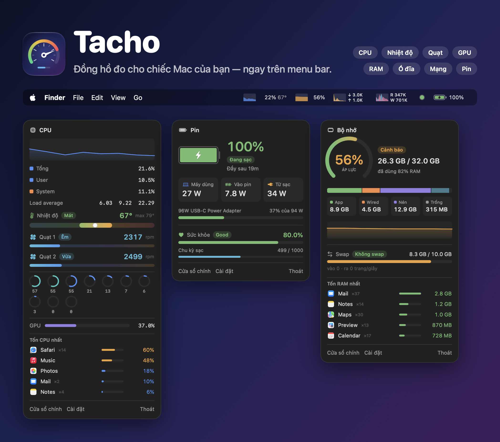
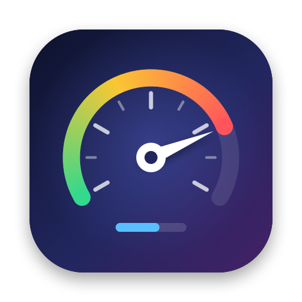
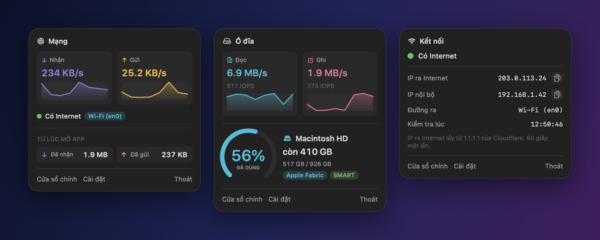
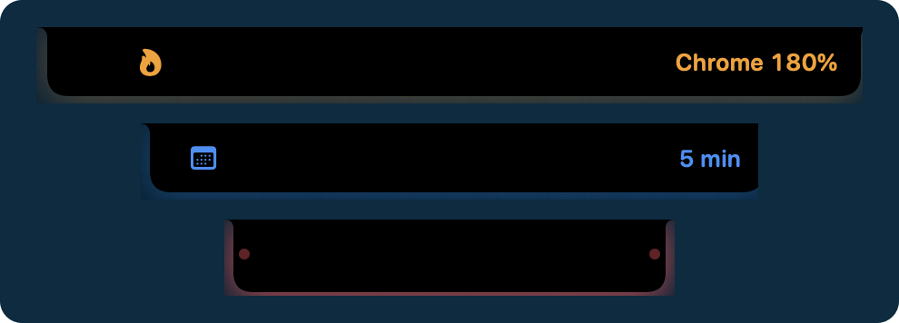
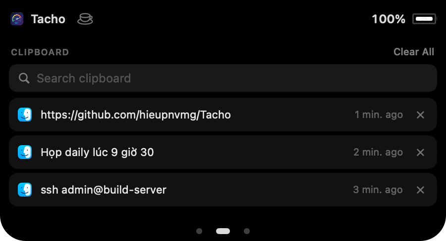
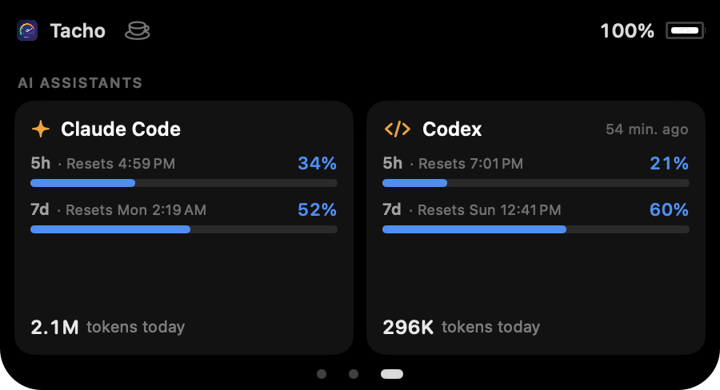
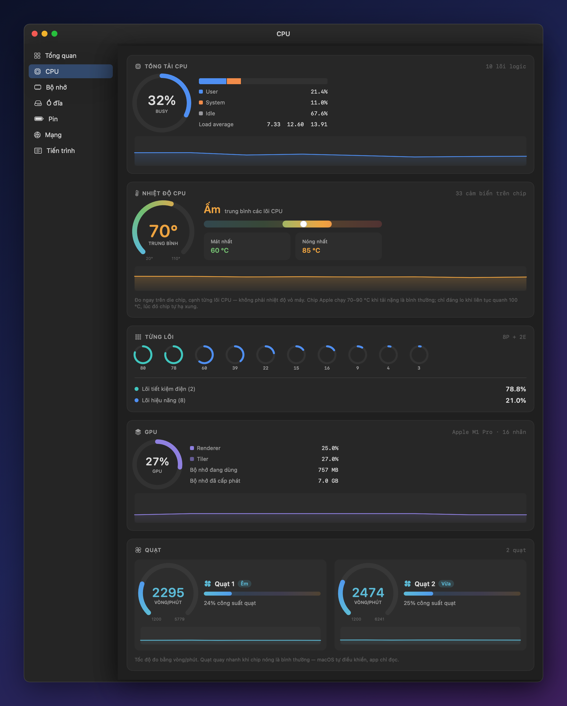
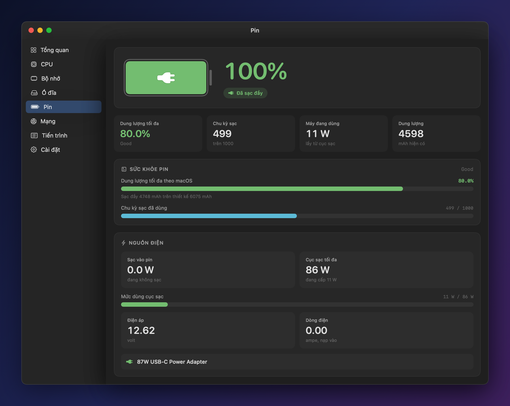
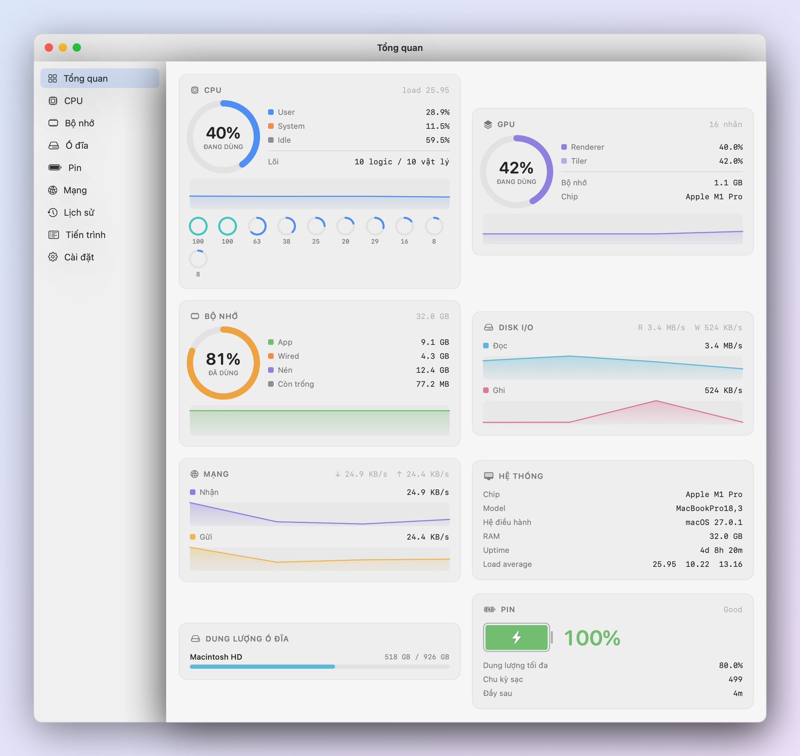
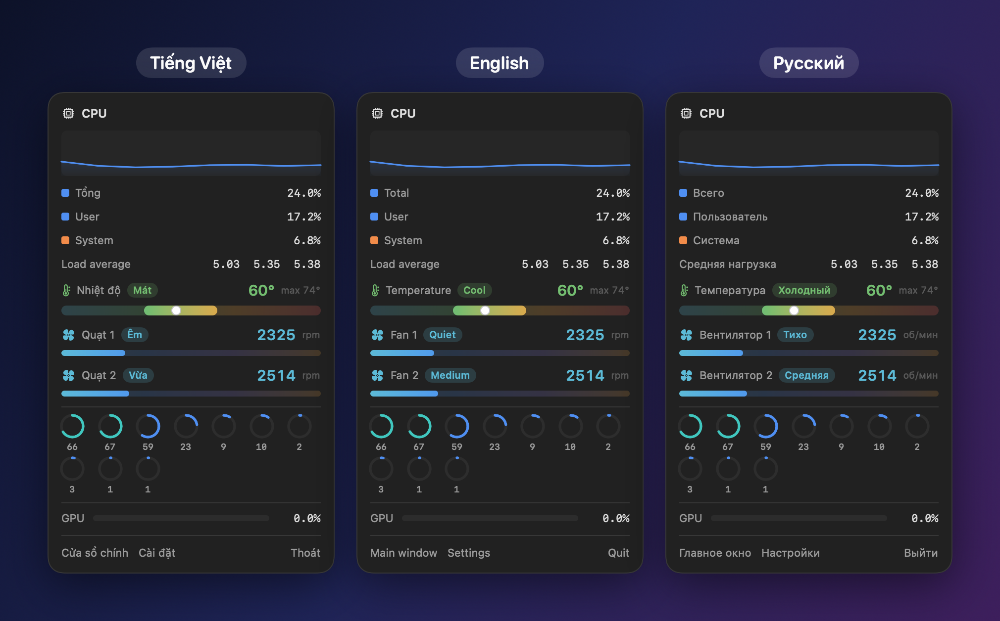

  

  

<h1 align="center">Tacho</h1>

  <b>Gauges for your Mac — in the menu bar and in the notch.</b> 
  CPU, temperature, fans, GPU, memory, disk, network, battery — and your Claude Code and Codex limits.

  <a href="https://github.com/hieupnvmg/Tacho/releases/latest/download/Tacho.dmg"><b>⬇︎ Download Tacho for macOS</b></a>
  &nbsp;·&nbsp; free &nbsp;·&nbsp; Apple silicon Macs, macOS 13 or later

  <a href="README.md">Tiếng Việt</a> &nbsp;·&nbsp; <b>English</b>

---

## Everything in the menu bar

Each reading is its own item with a live graph. Click one for the details, no window needed.

  

- **Network** — upload and download speed, whether you're online through Wi-Fi, Ethernet or a VPN,
  **which apps are using the network**, and a **speed test** that says whether it's good enough for video calls
- **Connection** — a green or red dot for Internet access, your public and local IP, click to copy
- **Disk** — read and write speed, and free space
- **What's slowing the Mac down** — the CPU and memory panels list the five heaviest apps, with helper
  processes (like Chrome's renderers) added to the app they belong to; one button opens Activity Monitor
- **Compact mode** — every reading in one small item, made for MacBooks with a notch
- **Docker and Kubernetes** — a small item: running containers, and a ⎈ that turns red when the
  Kubernetes context is production. Click it to start or quit Docker, start or stop containers, and see
  how much RAM Docker and each container use
- **CPU runner** — a cat, a dog, a coffee cup, an engine… runs in the menu bar, faster the busier the
  CPU. Eight come built in, or import your own from PNG frames (runners from the
  [Runner Gallery](https://runcat-dev.github.io/RunnerGallery/) work as they are)

## A notch that talks

The notch on a MacBook usually sits there doing nothing. Tacho has it spread its wings for a few
seconds when something happens, and opens a small control panel when you rest the pointer on it.

  

**The notch tells you when:** the charger goes in or out · the battery reaches 20% and 10% · AirPods,
a mouse or keyboard connect · the connection drops or comes back · a VPN comes up or drops, the public
IP changes · a call starts or ends · an app hogs
the CPU, the CPU runs hot, memory runs out · a meeting is 5 minutes away · a Claude Code or Codex limit
passes 80% and 95%. **While you share your screen** in a call, the notch keeps a red glow so you don't
forget.

**Rest the pointer on the notch to:**

- control what's playing in any app (YouTube, Spotify, Music…) and pick the speakers or headphones
- see the Teams, Zoom… call in progress, **mute the mic** with one button, bring the call window back
- **join a meeting** with one button — meetings come from the Mac's Calendar, Teams meetings from a
  Microsoft 365 account included
- **quit the app** that's hogging the CPU, right from the warning
- **keep the Mac awake** (no sleep, display stays on) until you turn it off, or for 1–2 hours
- **drop files on a shelf** — drag files onto the notch, then drag them somewhere else later

Swipe sideways with two fingers for the other pages:

<table>
  <tr>
    <td width="50%"></td>
    <td width="50%"></td>
  </tr>
  <tr>
    <td><b>Clipboard history</b> — the last 20 things you copied, searchable, click to copy again. Kept
    across restarts (you can turn that off), and passwords from password managers are skipped.</td>
    <td><b>Claude Code and Codex</b> — how much of the 5-hour and 7-day limits is used, when they reset,
    and today's tokens.</td>
  </tr>
</table>

## Know how hot it's running

CPU temperature measured on the chip, each fan's speed, load per core — with plain labels like
**Cool / Warm / Hot** and **Quiet / Medium / Loud** instead of bare numbers.

  

## Battery and charging, watt by watt

How many watts the Mac draws, how much is going into the battery, how long until it's full, and how
strong the charger is. Along with battery health, cycle count, and the batteries of your mouse,
keyboard and AirPods.

  

## The whole picture on one screen

  

Light and dark, following macOS. **24-hour history** lets you look back at CPU, temperature, memory,
network and battery.

## Tiếng Việt · English · Русский

Switch languages in Settings; it applies at once.

  

## And more

- **Timely alerts** — a hot CPU, low battery, a nearly full disk, no Internet; each can be turned off
- **Open at login** — one switch in Settings
- **Updates itself** — Tacho tells you when there's a new version; one click installs it
- **Light** — about a 3 MB download and around 2% CPU in the background; it starts quietly in the menu
  bar without opening a window
- **Private** — every reading comes from the Mac itself. Tacho only goes online to check the
  connection and look for updates, and both can be turned off. Calendar, clipboard and the Claude Code
  and Codex logs are read on the Mac and never sent anywhere
- **Your way** — choose which items show in the menu bar, turn graphs on or off, hide the Dock icon,
  change how often it updates; each notch feature has its own switch

## Install

1. Download [**Tacho.dmg**](https://github.com/hieupnvmg/Tacho/releases/latest/download/Tacho.dmg)
2. Open it and drag **Tacho** into **Applications**
3. The first time: **right-click Tacho → Open** (or **System Settings → Privacy & Security → Open Anyway**)

From then on Tacho updates itself. The notch features are under **Settings → Notch**. A few ask for
permission when you turn them on:

- **Accessibility** — so the play and skip buttons can send media keys
- **Calendar** — for meeting reminders
- **Claude Code** — click **Connect Claude Code** to make Tacho its statusLine so it can read the
  limits; they update when you use `claude` in a terminal. Codex limits are read directly, nothing to set up

## Credits

The menu bar runners and the way they're played come from
[RunCat Neo](https://github.com/runcat-dev/RunCatNeo), under the Apache License 2.0
(see [`Assets/Runners/NOTICE`](Assets/Runners/NOTICE)).

---

Want to build it yourself or contribute? See [how Tacho works](docs/HOW-IT-WORKS.md) (in Vietnamese).
