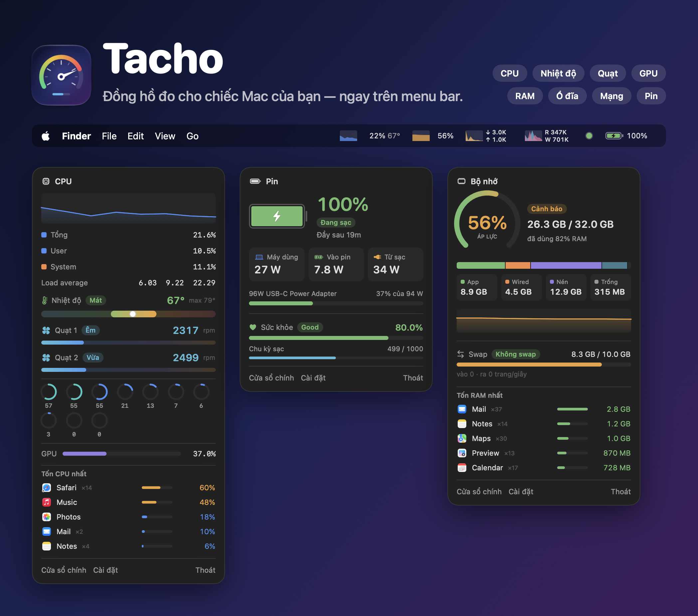
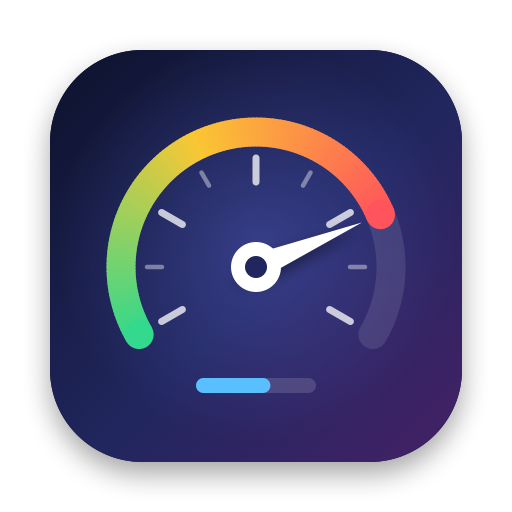
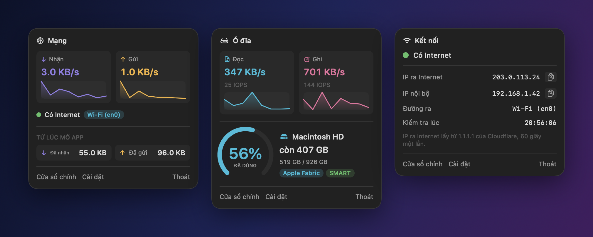
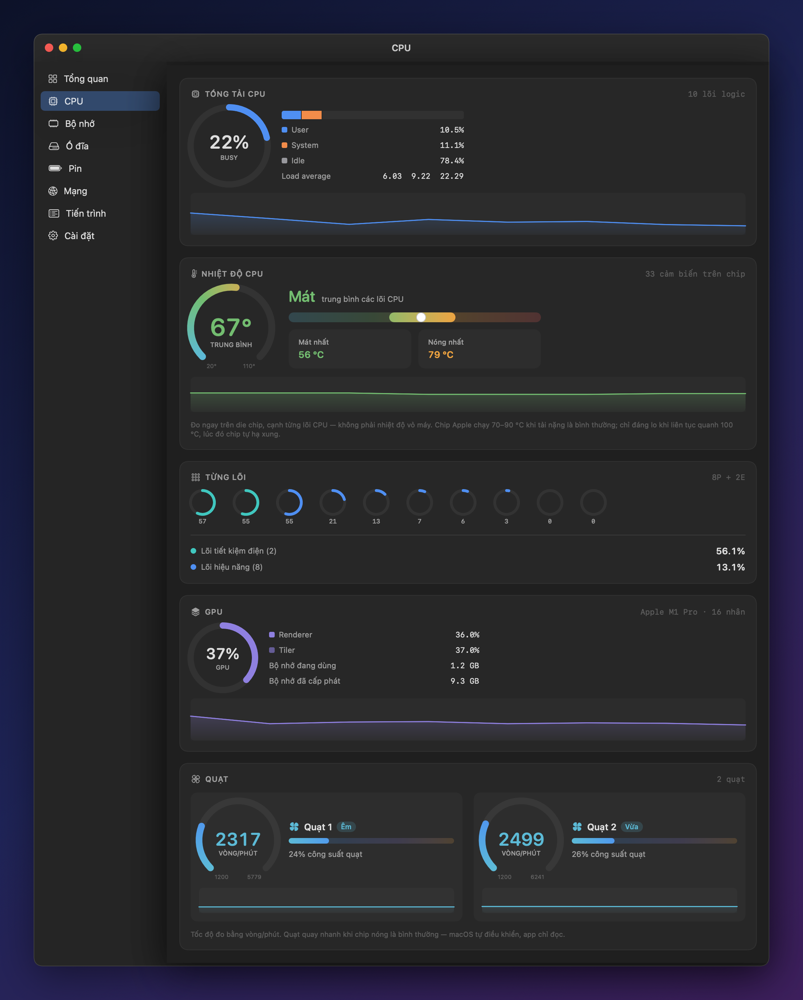
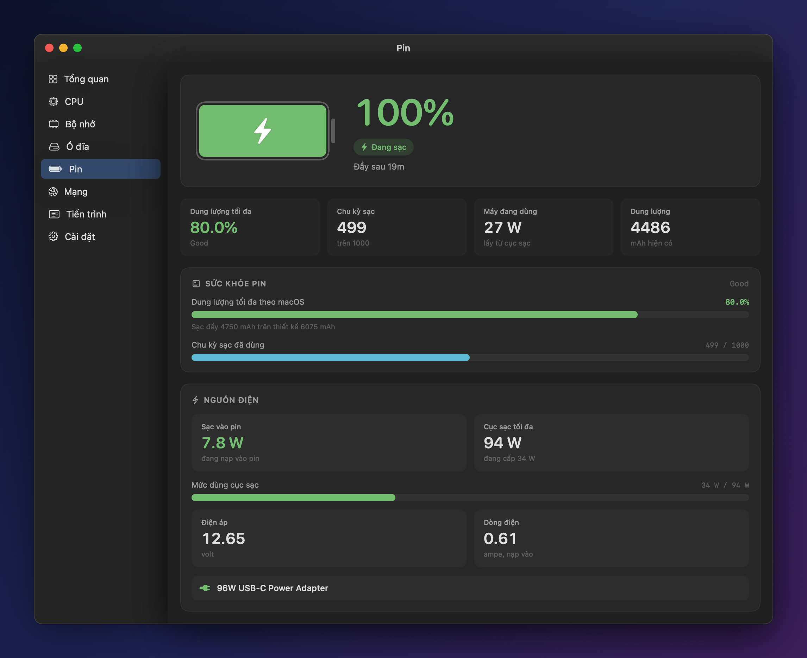
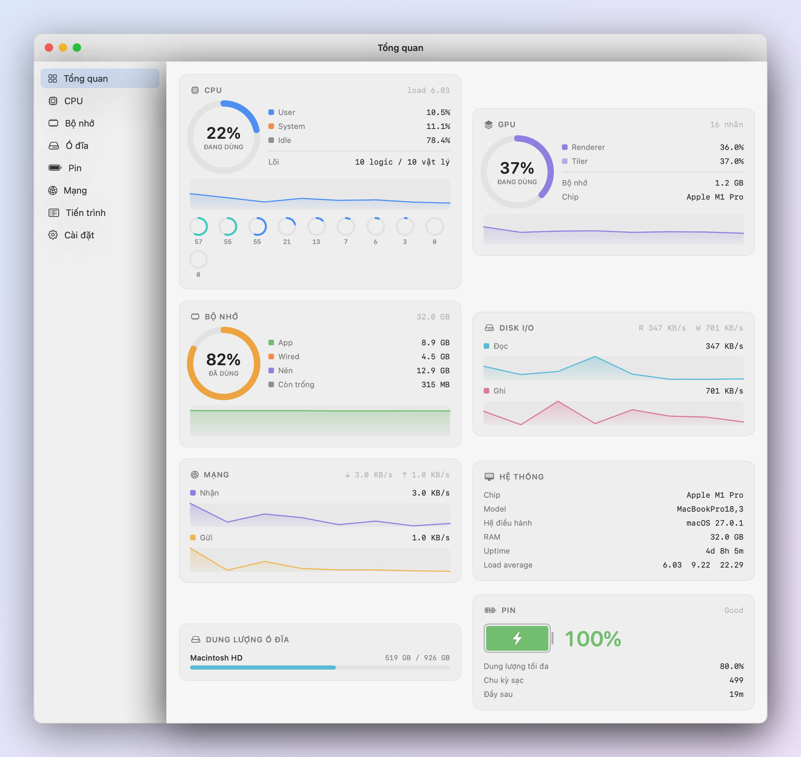
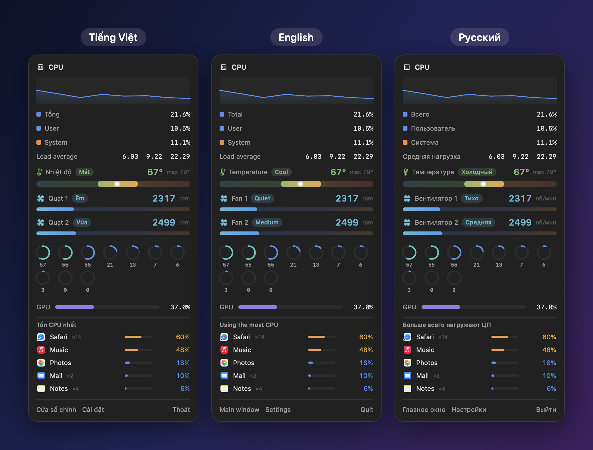

  

  

<h1 align="center">Tacho</h1>

  <b>Đồng hồ đo cho chiếc Mac của bạn — ngay trên menu bar.</b> 
  CPU, nhiệt độ, quạt, GPU, bộ nhớ, ổ đĩa, mạng và pin, nhìn một cái là biết máy đang ra sao.

  <a href="https://github.com/hieupnvmg/Tacho/releases/latest/download/Tacho.dmg"><b>⬇︎ Tải Tacho cho macOS</b></a>
  &nbsp;·&nbsp; miễn phí &nbsp;·&nbsp; Mac chip Apple, macOS 13 trở lên

---

## Mọi thứ trên menu bar

Mỗi chỉ số là một mục riêng với đồ thị chạy trực tiếp. Bấm vào là ra bảng chi tiết — không cần mở
cửa sổ nào.

  

- **Mạng** — tốc độ tải lên / tải xuống, đang ra Internet qua Wi-Fi, Ethernet hay VPN
- **Kết nối** — một chấm xanh/đỏ cho biết có Internet không, IP công khai và IP nội bộ, bấm là copy
- **Ổ đĩa** — tốc độ đọc/ghi và dung lượng còn trống

## Biết máy nóng tới đâu

Nhiệt độ CPU đo ngay trên chip, tốc độ từng quạt, tải từng lõi — kèm nhãn dễ hiểu như
**Mát / Ấm / Nóng** và **Êm / Vừa / Mạnh** thay cho những con số khô khan.

  

## Pin và sạc, rõ từng watt

Máy đang dùng bao nhiêu watt, đang sạc vào pin bao nhiêu, cục sạc mạnh tới đâu và đang chạy bao
nhiêu phần trăm công suất. Cùng với sức khỏe pin và số chu kỳ sạc.

  

## Toàn cảnh trong một màn hình

  

Giao diện sáng và tối theo macOS.

## Tiếng Việt · English · Русский

Đổi ngôn ngữ trong Cài đặt, áp dụng ngay.

  

## Và còn nữa

- **Biết ngay app nào đang ngốn máy** — bấm vào CPU hoặc RAM là thấy 5 app nặng nhất, các tiến trình
  phụ (như renderer của Chrome) được cộng gộp về đúng app
- **Cảnh báo kịp lúc** — CPU quá nóng, pin yếu, ổ đĩa sắp đầy, mất Internet; bật/tắt từng loại
- **Mở cùng máy** — một công tắc trong Cài đặt
- **Tự cập nhật** — có bản mới là Tacho báo, bấm một nút là xong
- **Nhẹ** — bản tải về chưa tới 3 MB, không chạy animation thừa
- **Riêng tư** — mọi số liệu đọc ngay trên máy; chỉ gọi mạng để kiểm tra Internet và bản cập nhật,
  tắt được cả hai
- **Tùy chọn** — chọn mục nào hiện trên menu bar, bật/tắt đồ thị, ẩn icon khỏi Dock, đổi tần suất cập nhật

## Cài đặt

1. Tải [**Tacho.dmg**](https://github.com/hieupnvmg/Tacho/releases/latest/download/Tacho.dmg)
2. Mở ra và kéo **Tacho** vào **Applications**
3. Lần đầu mở: **chuột phải vào Tacho → Open** (hoặc **System Settings → Privacy & Security → Open Anyway**)

Từ đó về sau Tacho tự cập nhật.

---

Muốn tự build hoặc đóng góp? Xem [cách Tacho hoạt động](docs/HOW-IT-WORKS.md).
