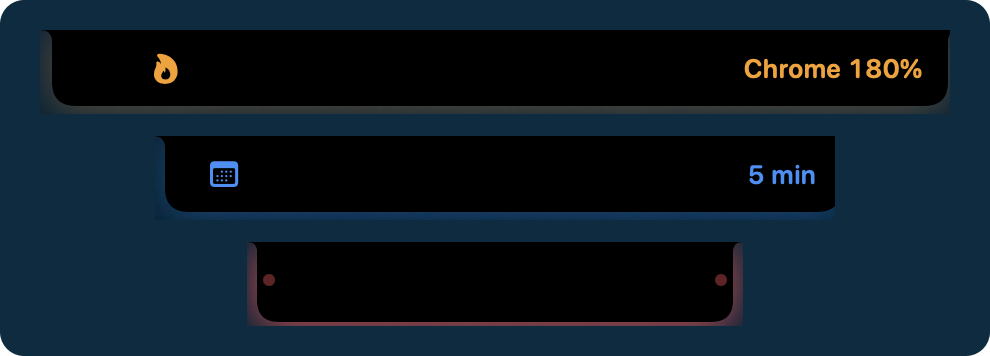
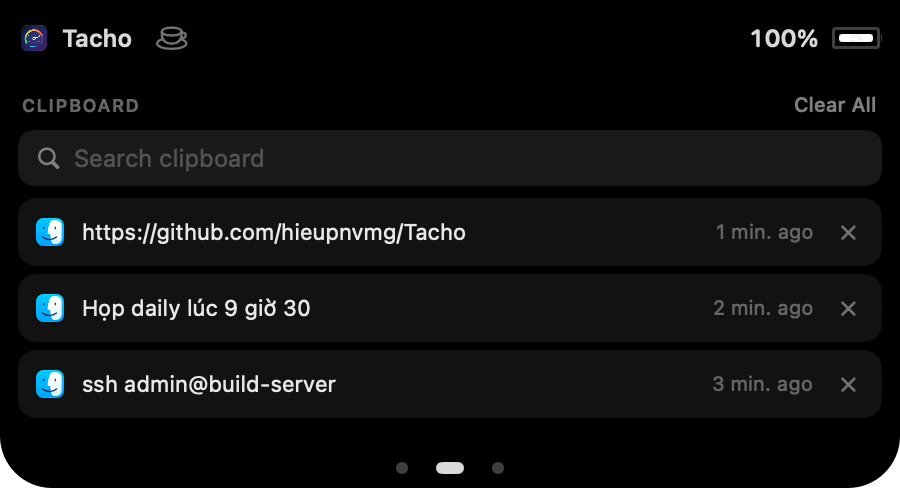
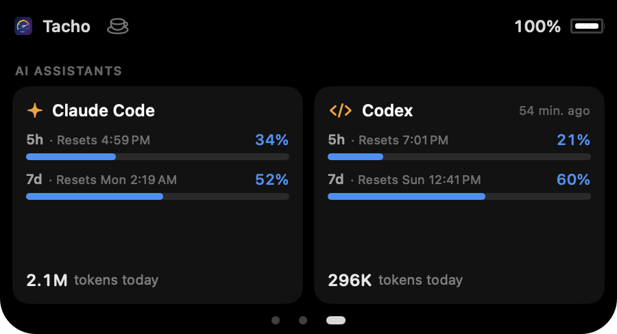

  

  

<h1 align="center">Tacho</h1>

  <b>Đồng hồ đo cho chiếc Mac của bạn — ngay trên menu bar và ở tai thỏ.</b> 
  CPU, nhiệt độ, quạt, GPU, bộ nhớ, ổ đĩa, mạng, pin — và cả hạn mức Claude Code, Codex.

  <a href="https://github.com/hieupnvmg/Tacho/releases/latest/download/Tacho.dmg"><b>⬇︎ Tải Tacho cho macOS</b></a>
  &nbsp;·&nbsp; miễn phí &nbsp;·&nbsp; Mac chip Apple, macOS 13 trở lên

  <b>Tiếng Việt</b> &nbsp;·&nbsp; <a href="README.en.md">English</a>

---

## Mọi thứ trên menu bar

Mỗi chỉ số là một mục riêng với đồ thị chạy trực tiếp. Bấm vào là ra bảng chi tiết, không cần mở
cửa sổ nào.

  

- **Mạng** — tốc độ tải lên / tải xuống, đang ra Internet qua Wi-Fi, Ethernet hay VPN, **app nào đang
  dùng mạng**, và nút **đo tốc độ mạng** cho biết có đủ tốt để họp video không
- **Kết nối** — một chấm xanh/đỏ cho biết có Internet không, IP công khai và IP nội bộ, bấm là copy
- **Ổ đĩa** — tốc độ đọc/ghi và dung lượng còn trống
- **App nào đang ngốn máy** — bảng CPU và RAM liệt kê 5 app nặng nhất, tiến trình phụ (như renderer
  của Chrome) được cộng về đúng app; một nút mở thẳng Activity Monitor
- **Chế độ gọn** — gộp mọi chỉ số vào một mục nhỏ, hợp với MacBook có tai thỏ
- **Docker và Kubernetes** — một mục nhỏ: số container đang chạy và biểu tượng ⎈ chuyển đỏ khi context
  Kubernetes là production. Bấm vào để bật/tắt Docker, chạy/dừng từng container, xem RAM Docker và
  từng container đang dùng
- **Hình chạy theo CPU** — mèo, chó, cà phê, động cơ… chạy trên menu bar, CPU càng bận càng chạy
  nhanh. Có sẵn 8 hình, hoặc nhập hình của riêng bạn từ ảnh PNG (dùng được hình từ
  [Runner Gallery](https://runcat-dev.github.io/RunnerGallery/))

## Tai thỏ biết nói

Phần tai thỏ trên MacBook vốn bỏ trống. Tacho cho nó giãn ra báo tin trong vài giây, và rê chuột vào
thì mở ra một bảng điều khiển nhỏ.

  

**Tai thỏ báo khi:** cắm hoặc rút sạc · pin còn 20% và 10% · AirPods, chuột, bàn phím vừa kết nối ·
mất mạng hoặc có mạng lại · VPN bật hoặc rớt, IP ra Internet đổi · cuộc gọi bắt đầu hoặc kết thúc · một app ngốn CPU, CPU quá nóng, hết RAM ·
5 phút trước cuộc họp · hạn mức Claude Code hoặc Codex vượt 80% và 95%. **Đang chia sẻ màn hình**
trong cuộc gọi thì tai thỏ giữ viền đỏ để bạn khỏi quên.

**Rê chuột vào tai thỏ để:**

- điều khiển nhạc đang phát ở bất kỳ app nào (YouTube, Spotify, Nhạc…) và chọn loa hoặc tai nghe
- xem cuộc gọi Teams, Zoom… đang diễn ra, **tắt micro** bằng một nút, mở lại cửa sổ cuộc gọi
- **vào họp** bằng một nút — cuộc họp lấy từ Lịch của macOS, kể cả họp Teams của tài khoản Microsoft 365
- **thoát app** đang ngốn CPU ngay trong cảnh báo
- **giữ máy thức** (không ngủ, không tắt màn hình) đến khi tắt, hoặc trong 1–2 giờ
- **thả file tạm lên kệ** — kéo file lên tai thỏ, rồi kéo ra chỗ khác sau

Vuốt hai ngón sang ngang để sang các trang khác:

<table>
  <tr>
    <td width="50%"></td>
    <td width="50%"></td>
  </tr>
  <tr>
    <td><b>Lịch sử clipboard</b> — 20 mục copy gần nhất, tìm không cần dấu, bấm để copy lại. Giữ qua
    các lần khởi động lại (tắt được), bỏ qua mật khẩu từ trình quản lý mật khẩu.</td>
    <td><b>Claude Code và Codex</b> — % hạn mức 5 giờ và 7 ngày, giờ reset, token đã dùng hôm nay.</td>
  </tr>
</table>

## Biết máy nóng tới đâu

Nhiệt độ CPU đo ngay trên chip, tốc độ từng quạt, tải từng lõi — kèm nhãn dễ hiểu như
**Mát / Ấm / Nóng** và **Êm / Vừa / Mạnh** thay cho những con số khô khan.

  

## Pin và sạc, rõ từng watt

Máy đang dùng bao nhiêu watt, đang sạc vào pin bao nhiêu, còn bao lâu thì đầy, cục sạc mạnh tới đâu.
Cùng với sức khỏe pin, số chu kỳ sạc, và pin của chuột, bàn phím, AirPods.

  

## Toàn cảnh trong một màn hình

  

Giao diện sáng và tối theo macOS. Có **lịch sử 24 giờ** để xem lại CPU, nhiệt độ, bộ nhớ, mạng, pin.

## Tiếng Việt · English · Русский

Đổi ngôn ngữ trong Cài đặt, áp dụng ngay.

  

## Và còn nữa

- **Cảnh báo kịp lúc** — CPU quá nóng, pin yếu, ổ đĩa sắp đầy, mất Internet; bật/tắt từng loại
- **Mở cùng máy** — một công tắc trong Cài đặt
- **Tự cập nhật** — có bản mới là Tacho báo, bấm một nút là xong
- **Nhẹ** — bản tải về khoảng 3 MB, khoảng 2% CPU khi chạy nền; mở máy là nằm gọn trên menu bar, không
  tự bật cửa sổ
- **Riêng tư** — mọi số liệu đọc ngay trên máy. Tacho chỉ gọi mạng để kiểm tra Internet và tìm bản cập
  nhật, tắt được cả hai. Lịch, clipboard và nhật ký Claude Code / Codex chỉ được đọc trên máy, không gửi đi đâu
- **Tùy chọn** — chọn mục nào hiện trên menu bar, bật/tắt đồ thị, ẩn icon khỏi Dock, đổi tần suất
  cập nhật; mỗi tính năng tai thỏ bật/tắt riêng

## Cài đặt

1. Tải [**Tacho.dmg**](https://github.com/hieupnvmg/Tacho/releases/latest/download/Tacho.dmg)
2. Mở ra và kéo **Tacho** vào **Applications**
3. Lần đầu mở: **chuột phải vào Tacho → Open** (hoặc **System Settings → Privacy & Security → Open Anyway**)

Từ đó về sau Tacho tự cập nhật. Tính năng tai thỏ bật trong **Cài đặt → Tai thỏ**. Một vài tính năng
sẽ xin quyền khi bạn bật:

- **Trợ năng** — để các nút phát, chuyển bài gửi được phím media
- **Lịch** — để nhắc cuộc họp
- **Claude Code** — bấm **Kết nối Claude Code** để Tacho làm statusLine và đọc được hạn mức; số cập nhật
  khi bạn dùng `claude` trong terminal. Hạn mức Codex đọc thẳng, không cần làm gì

## Ghi công

Các hình chạy trên menu bar và cách cho chúng chạy lấy từ
[RunCat Neo](https://github.com/runcat-dev/RunCatNeo), theo giấy phép Apache 2.0
(xem [`Assets/Runners/NOTICE`](Assets/Runners/NOTICE)).

---

Muốn tự build hoặc đóng góp? Xem [cách Tacho hoạt động](docs/HOW-IT-WORKS.md).
