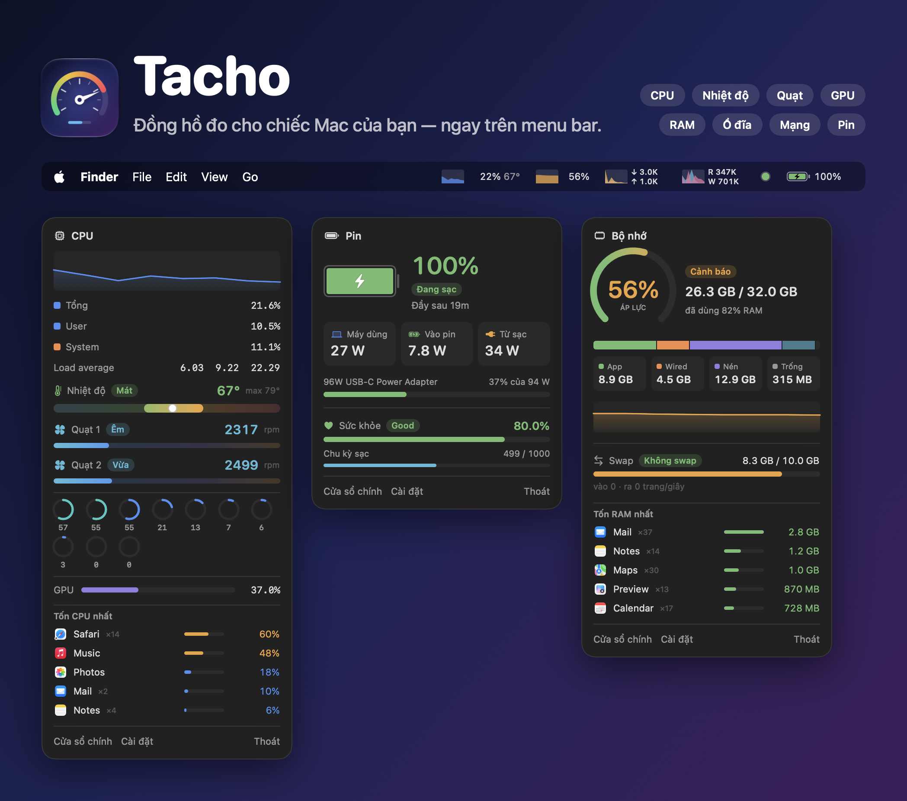
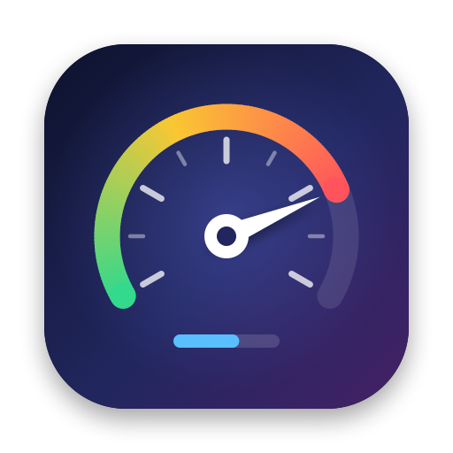
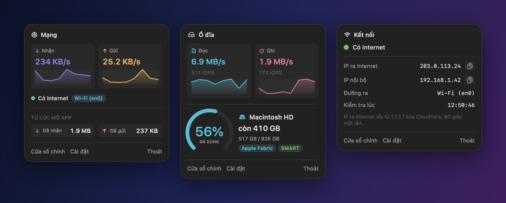
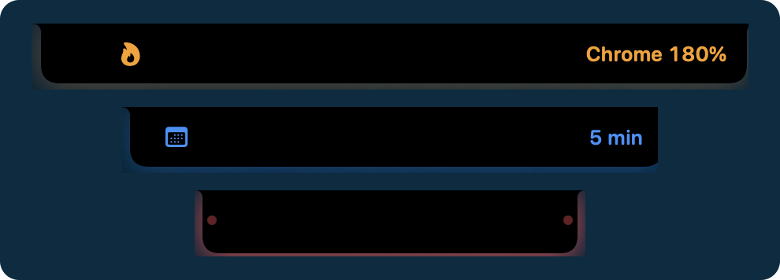
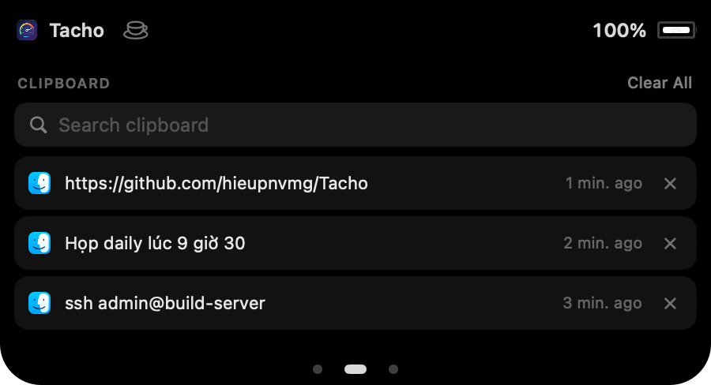
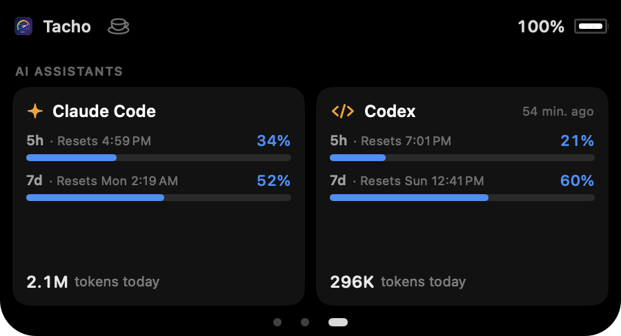
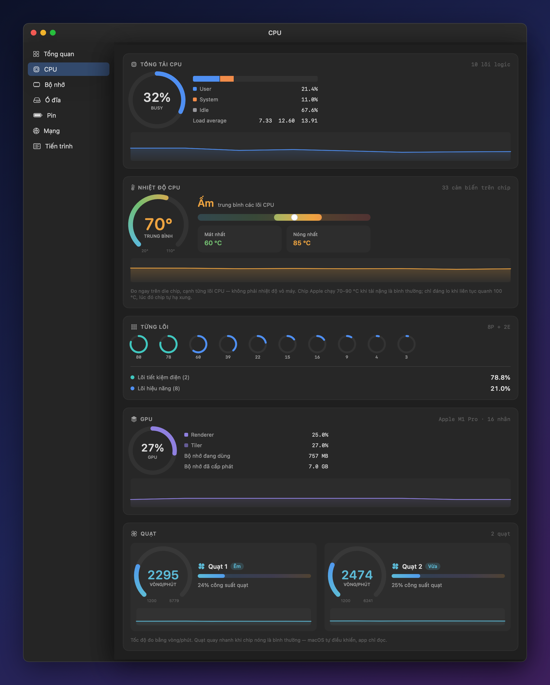
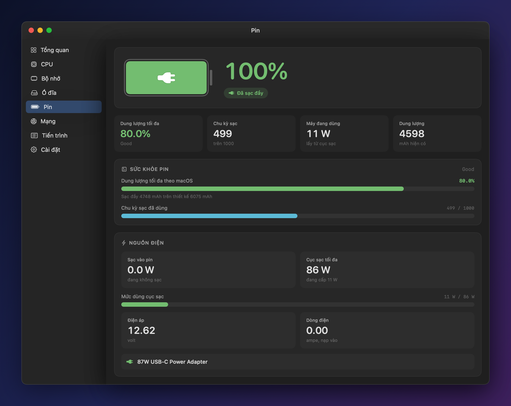
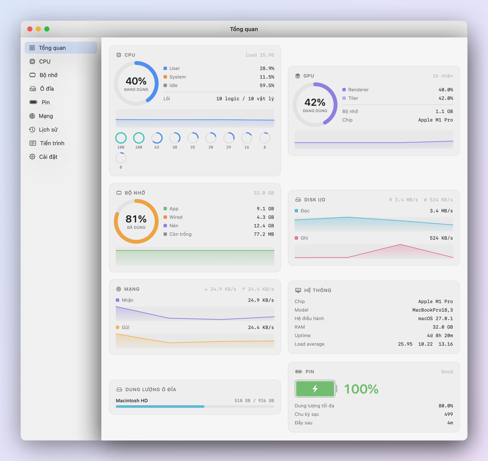
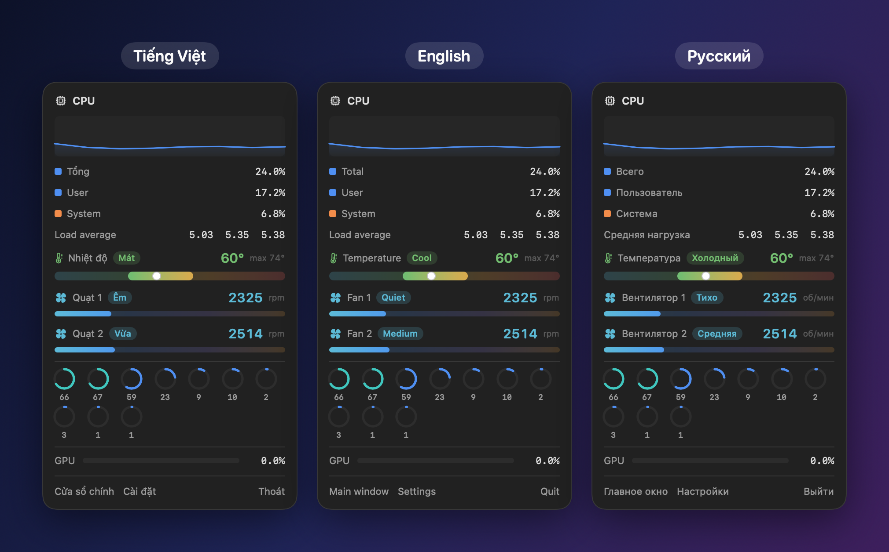

<p align="center">
  
</p>

<p align="center">
  
</p>

<h1 align="center">Tacho</h1>

<p align="center">
  <b>Đồng hồ đo cho chiếc Mac của bạn — ngay trên menu bar và ở tai thỏ.</b><br>
  CPU, nhiệt độ, quạt, GPU, bộ nhớ, ổ đĩa, mạng, pin, Docker và Kubernetes — và cả hạn mức Claude Code, Codex.
</p>

<p align="center">
  <a href="https://github.com/hieupnvmg/Tacho/releases/latest/download/Tacho.dmg"><b>⬇︎ Tải Tacho cho macOS</b></a>
  &nbsp;·&nbsp; hoặc <a href="#cài-đặt">cài bằng Homebrew</a>
  <br>miễn phí &nbsp;·&nbsp; Mac chip Apple, macOS 13 trở lên
</p>

<p align="center">
  <a href="README.md">English</a> &nbsp;·&nbsp; <b>Tiếng Việt</b>
</p>

---

## Tổng quan nhanh

| | |
|---|---|
| **Menu bar** | CPU, GPU, bộ nhớ, ổ đĩa, mạng, kết nối, pin — mỗi chỉ số một đồ thị chạy trực tiếp, hoặc gộp vào một mục nhỏ |
| **Bảng chi tiết** | Bấm vào một chỉ số: app nặng nhất, app đang dùng mạng, đo tốc độ mạng, sức khỏe pin, pin phụ kiện |
| **Tai thỏ** | Báo tin ngắn ở hai bên tai thỏ, và một bảng điều khiển khi rê chuột vào: nhạc, loa, cuộc gọi, cuộc họp, file, clipboard, hạn mức AI |
| **Cho dân kỹ thuật** | Hạn mức và token Claude Code, Codex; container Docker và context Kubernetes |
| **Hình chạy theo CPU** | Một chú mèo (hoặc hình của bạn) chạy càng nhanh khi CPU càng bận |
| **Cửa sổ** | Tổng quan, CPU, bộ nhớ, ổ đĩa, pin, mạng, lịch sử 24 giờ và mọi tiến trình |
| **Cảnh báo** | CPU quá nóng, pin yếu, ổ đĩa sắp đầy, mất Internet — bằng thông báo hoặc trên tai thỏ |
| **Ngôn ngữ** | English, Tiếng Việt, Русский |

## Mọi thứ trên menu bar

Mỗi chỉ số là một mục riêng với đồ thị chạy trực tiếp. Bấm vào là ra bảng chi tiết, không cần mở
cửa sổ nào.

<p align="center">
  
</p>

- **CPU và GPU** — tải, nhiệt độ (cam khi ấm, đỏ khi nóng), và 5 app nặng nhất; tiến trình phụ (như
  renderer của Chrome) được cộng về đúng app
- **Bộ nhớ** — áp lực bộ nhớ, tô màu như Activity Monitor, và các app dùng nhiều nhất
- **Mạng** — tốc độ tải lên / tải xuống, đang ra Internet qua Wi-Fi, Ethernet hay VPN, **app nào đang
  dùng mạng**, và nút **đo tốc độ mạng** cho biết có đủ tốt để họp video không
- **Kết nối** — một chấm cho biết có Internet không, IP công khai và IP nội bộ, bấm là copy
- **Ổ đĩa** — tốc độ đọc/ghi và dung lượng còn trống
- **Pin** — mức pin, thời gian đến đầy hoặc đến hết, công suất cục sạc, và pin chuột, bàn phím, AirPods
- **Chế độ gọn** — gộp mọi chỉ số vào một mục nhỏ, hợp với MacBook có tai thỏ
- **Docker và Kubernetes** — số container đang chạy, và biểu tượng ⎈ **chuyển đỏ khi context
  Kubernetes là production**. Bấm vào để bật/tắt Docker Desktop (hoặc OrbStack), chạy/dừng từng
  container, xem RAM Docker và từng container đang dùng
- **Hình chạy theo CPU** — mèo, chó, cà phê, động cơ… chạy trên menu bar, CPU càng bận càng chạy
  nhanh. Có sẵn 8 hình, hoặc nhập hình của riêng bạn từ ảnh PNG (dùng được hình từ
  [Runner Gallery](https://runcat-dev.github.io/RunnerGallery/))
- **Activity Monitor** mở được bằng một nút ở mọi bảng

## Tai thỏ biết nói

Phần tai thỏ trên MacBook vốn bỏ trống. Tacho cho nó giãn ra báo tin trong vài giây, và rê chuột vào
thì mở ra một bảng điều khiển nhỏ.

<p align="center">
  
</p>

**Tai thỏ báo khi:**

- cắm hoặc rút sạc, pin còn 20% và 10%
- AirPods, chuột, bàn phím vừa kết nối
- mất mạng hoặc có mạng lại, VPN bật hoặc rớt, IP ra Internet đổi
- cuộc gọi bắt đầu hoặc kết thúc — và **khi đang chia sẻ màn hình** thì giữ viền đỏ để bạn khỏi quên
- một app ngốn CPU, CPU quá nóng, hết RAM
- 5 phút trước cuộc họp, và lúc cuộc họp bắt đầu
- hạn mức Claude Code hoặc Codex vượt 80% và 95%

**Rê chuột vào tai thỏ để:**

- điều khiển nhạc đang phát ở bất kỳ app nào (YouTube, Spotify, Nhạc…) và chọn loa hoặc tai nghe
- xem cuộc gọi Teams, Zoom… đang diễn ra, **tắt micro**, biết camera có đang bật không, mở lại cửa sổ
  cuộc gọi
- **vào cuộc họp kế tiếp** bằng một nút — cuộc họp lấy từ Lịch của macOS, kể cả họp Teams của tài
  khoản Microsoft 365
- **thoát app** đang ngốn CPU ngay trong cảnh báo
- **giữ máy thức** đến khi tắt, hoặc trong 1–2 giờ
- **thả file tạm lên kệ** — kéo file lên tai thỏ, rồi kéo ra chỗ khác sau
- xem **thời gian sạc đầy** khi đang cắm sạc

Vuốt hai ngón sang ngang (trackpad hoặc Magic Mouse) để sang các trang khác, và chọn được tai thỏ mở
ở trang nào:

<table>
  <tr>
    <td width="50%"></td>
    <td width="50%"></td>
  </tr>
  <tr>
    <td><b>Lịch sử clipboard</b> — 20 mục copy gần nhất, tìm không cần dấu, bấm để copy lại. Giữ qua
    các lần khởi động lại, hoặc chỉ trong bộ nhớ nếu bạn muốn; bỏ qua mật khẩu từ trình quản lý mật
    khẩu.</td>
    <td><b>Claude Code và Codex</b> — % hạn mức 5 giờ và 7 ngày, giờ reset, token đã dùng hôm nay.
    Codex đọc thẳng từ nhật ký; hạn mức Claude Code lấy qua statusLine, và Tacho chạy kèm được
    statusLine bạn đang có.</td>
  </tr>
</table>

## Biết máy nóng tới đâu

Nhiệt độ CPU đo ngay trên chip, tốc độ từng quạt, tải từng lõi — kèm nhãn dễ hiểu như
**Mát / Ấm / Nóng** và **Êm / Vừa / Mạnh** thay cho những con số khô khan.

<p align="center">
  
</p>

## Pin và sạc, rõ từng watt

Máy đang dùng bao nhiêu watt, đang sạc vào pin bao nhiêu, còn bao lâu thì đầy, cục sạc mạnh tới đâu.
Cùng với sức khỏe pin, số chu kỳ sạc, và pin của chuột, bàn phím, AirPods.

<p align="center">
  
</p>

## Toàn cảnh trong một màn hình

<p align="center">
  
</p>

Giao diện sáng và tối theo macOS. **Lịch sử 24 giờ** để xem lại CPU, nhiệt độ, bộ nhớ, mạng, pin, và
tab **Tiến trình** liệt kê mọi thứ đang chạy.

## English · Tiếng Việt · Русский

Đổi ngôn ngữ trong Cài đặt, áp dụng ngay.

<p align="center">
  
</p>

## Và còn nữa

- **Cảnh báo kịp lúc** — CPU quá nóng, pin yếu, pin đã đầy, pin phụ kiện yếu, ổ đĩa sắp đầy, mất
  Internet; bật/tắt từng loại
- **Mở cùng máy** — một công tắc trong Cài đặt; khởi động gọn trên menu bar, không tự bật cửa sổ
- **Tự cập nhật** — có bản mới là Tacho báo, bấm một nút là xong
- **Nhẹ** — bản tải về khoảng 3 MB, khoảng 2% CPU khi chạy nền; các bảng và trang chỉ làm việc khi
  bạn đang xem
- **Riêng tư** — mọi số liệu đọc ngay trên máy. Tacho chỉ gọi mạng để kiểm tra Internet và tìm bản cập
  nhật, tắt được cả hai. Lịch, clipboard, Docker, Kubernetes và nhật ký Claude Code / Codex chỉ được
  đọc trên máy, không gửi đi đâu
- **Tùy chọn** — chọn mục nào hiện trên menu bar, bật/tắt đồ thị, ẩn icon khỏi Dock, đổi tần suất
  cập nhật; mỗi tính năng tai thỏ bật/tắt riêng

## Cài đặt

1. Tải [**Tacho.dmg**](https://github.com/hieupnvmg/Tacho/releases/latest/download/Tacho.dmg)
2. Mở ra và kéo **Tacho** vào **Applications**
3. Lần đầu mở: **chuột phải vào Tacho → Open** (hoặc **System Settings → Privacy & Security → Open Anyway**)

Hoặc cài bằng Homebrew:

```bash
brew tap hieupnvmg/tacho
brew trust hieupnvmg/tacho
brew install --cask tacho
```

Từ đó về sau Tacho tự cập nhật. Tính năng tai thỏ nằm trong **Cài đặt → Tai thỏ**, hình chạy và mục
Docker/Kubernetes trong **Cài đặt → Hiển thị**. Một vài tính năng sẽ xin quyền khi bạn bật:

- **Trợ năng** — để các nút phát, chuyển bài gửi được phím media
- **Lịch** — để nhắc cuộc họp
- **Claude Code** — bấm **Kết nối Claude Code** để Tacho làm statusLine và đọc được hạn mức (giữ nguyên
  statusLine bạn đang có); số cập nhật khi bạn dùng `claude` trong terminal. Codex không cần làm gì

## Cho người tò mò

Chính file chạy của Tacho trả lời được vài câu hỏi từ terminal
(`/Applications/Tacho.app/Contents/MacOS/Tacho …`):

| | |
|---|---|
| `--dump` | mọi số liệu, một lần |
| `--notch-demo` | chạy lần lượt các trạng thái tai thỏ, để xem hoặc quay lại |
| `--notch-info` | bảng tai thỏ nằm ở đâu, và cuộc gọi nó thấy |
| `--ai-usage` | mức dùng Claude Code và Codex như trang AI đọc |
| `--network-info` | giao diện VPN và các app đang dùng mạng |
| `--infra-info` | Docker và Kubernetes như mục menu bar thấy |
| `--claude-connect` / `--claude-disconnect` | nút trong Cài đặt, dùng cho script |

## Ghi công

Các hình chạy trên menu bar và cách cho chúng chạy lấy từ
[RunCat Neo](https://github.com/runcat-dev/RunCatNeo), theo giấy phép Apache 2.0
(xem [`Assets/Runners/NOTICE`](Assets/Runners/NOTICE)).

---

<sub>Muốn tự build hoặc đóng góp? Xem [cách Tacho hoạt động](docs/HOW-IT-WORKS.md).</sub>
